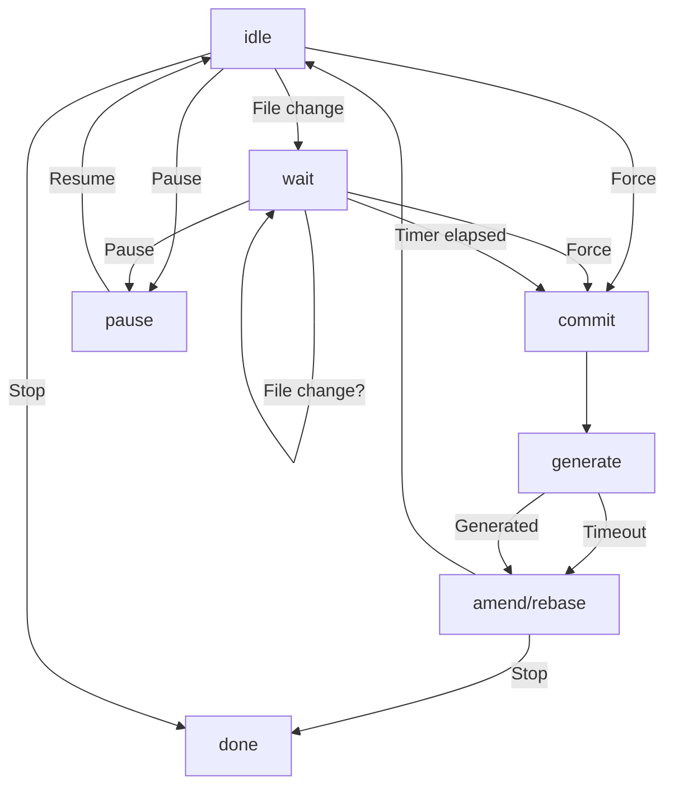

# clankistorian

A tool that makes Git commits while you work and uses an LLM to write best-effort commit messages so you can squash them into something meaningful later.

## Interface

* `clank config` - Opens `$EDITOR` to `~/.config/clankistorian.toml`.
  * `clank config --local` - Finds the nearest ancestor git repo and opens `$EDITOR` to `clankistorian.toml` in its root.
* `clank start` - Spawns an instance of the daemon for this project. Creates a communication socket at `$XDG_RUNTIME_DIR/clankistorian/$REPO_PATH.sock`, where `$REPO_PATH` is the path to the root of the repo with slashes replaced with hyphens.
* `clank stop` - Instructs clankistorian to stop, then waits for it to finish before exiting itself.
* `clank pause` - Keep the daemon running, but stop it from committing.
* `clank resume` - Unpause the daemon.
* `clank force` - Force the daemon to make a commit right now.

## Configuration

```toml
# TOML
endpoint = "http://127.0.0.1:11434/v1" # OpenAI-compatible endpoint.
token = "..." # Ideally, pass as $CLANKISTORIAN_TOKEN instead
model = "ornith-1.5:9b" # Model ID to use for commit generation.
context = 16384 # LLM context window.
think = true # Ask the model to think.
prefix = "C:" # Prefix to apply to all auto-commits.
prompt = "You have been given a summary of recent commits on a Git repository and the diff of a new commit. This commit was automatically made while a human user worked. Commits beginning with `C:` were written by previous iterations of yourself. Your job is to write a best-effort commit message to help the user remember what they did so that they can squash these commits later." # LLM system prompt.
ignored_files = ["log/**/*"] # Files to ignore when watching.
noisy_files = ["Cargo.lock"] # Files to strip from the diff to save context.
wait_before_commit = 15 # Time to wait after seeing a change before committing.
wait_resets_on_change = true # Reset the commit wait timer when we see a change.
wait_timeout = 30 # Time limit in seconds. Starts instantly and ends on the first token.
write_timeout = 300 # Time limit in seconds. Starts on the first token and ends on the last token.
timeout_msg = "(LLM timed out.)" # Commit message to use when the LLM times out.
```

## State machine


